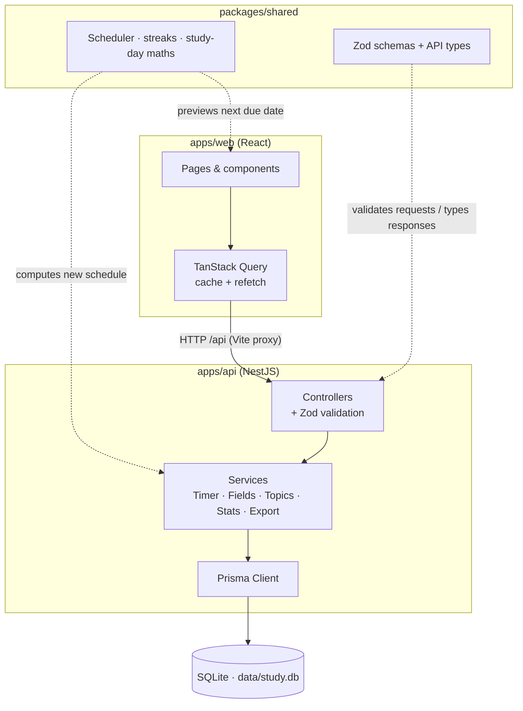
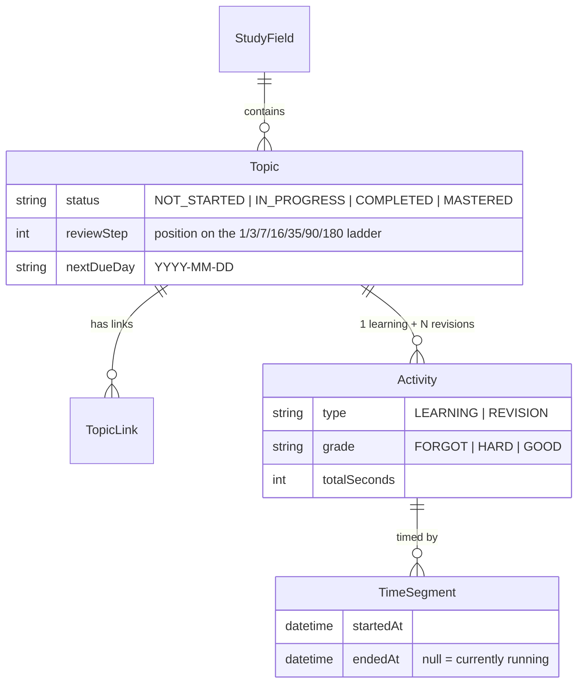

# Study Tracker

A local-first study tracker for people who learn deeply, then forget. Create a **study field** (e.g. "DSA 2026"), add **topics** as you start them, time every session, and get **spaced-repetition revisions** scheduled as a queue rather than a calendar. Missed days never break the plan, and a streak calendar shows your consistency.

Works for any subject: coding interviews, exams, languages.

## Features

- **Study fields and topics** with descriptions, any number of labelled links, and an optional *recall prompt*.
- **One global timer**: start, pause, resume, end. Starting something new auto-pauses whatever was running.
- **Spaced repetition**: revisions at 1 → 3 → 7 → 16 → 35 → 90 → 180 days, then *Mastered*. Each revision is graded **Forgot / Hard / Good**:
  - Good moves to the next step, Hard repeats the step, Forgot goes back to step 1.
  - The next interval counts from the day you **actually** revised, so being late never stacks up penalties.
- **Recall first**: revisions show your recall prompt before revealing notes and links.
- **Field page** with total / learning / revision time, recall rate, and tabs: Ongoing · All topics · Revised · Revisions (due now, capped at 5/day, plus the next 2 days) · History.
- **Streaks**: completing any topic or revision counts for the day. Current and longest streak, shown as a heatmap or a month calendar.
- **Long-session guard**: if a timer has run for 3h+, the app asks whether you forgot to stop it.
- **Fix your time log**: edit or remove any finished session; overlapping sessions are rejected.
- **Discard a revision** started by mistake, without it counting.
- **"No revision needed"** for topics worth studying once (intros, overviews): they count as done but stay out of the revision queue.
- **Settings**: your own interval ladder, daily revision cap, day-start hour (e.g. 04:00 for night owls) and long-session limit.
- **Light and dark themes** with a one-click toggle.
- **Archive or delete** fields and topics; **export** everything to JSON and **import** it back.

## Quick start

Requires Node.js 20+ (built on Node 24).

```bash
npm install
```

```bash
npm run dev
```

Open http://127.0.0.1:5173. The API runs on http://127.0.0.1:3001/api.

On first run, `npm run dev` creates the SQLite database at `data/study.db`.

> npm 11+ blocks dependency install scripts unless approved. This repo approves only Prisma's packages (`allowScripts` in `package.json`); they need their install script to download the query engine.

## Your data

- Everything is stored in `data/study.db` on your machine. The app binds to `127.0.0.1` only and makes no external network calls.
- `data/` is git-ignored, so your study history never ends up in the repository.
- Back up by copying `data/study.db`, or use **Profile → Export all data (JSON)**.

## Architecture

Three TypeScript packages in one npm-workspaces repo. Everything runs on your machine.



Solid arrows are runtime calls; dotted arrows are code shared at build time.

**How it fits together**

- **Shared package, one source of truth.** The revision rules, streak maths and request schemas live in `packages/shared` as plain functions with no I/O. The API uses them to save the new schedule; the UI uses the *same* functions to preview "if you grade Good, the next revision is on 11 Nov". The two can't disagree.
- **Thin API layers.** Controllers only validate input (with the shared Zod schemas) and route. Services hold the logic, and every timer change runs inside one database transaction.
- **One timer for the whole app.** At most one time segment is open (`endedAt = null`) at any moment. Starting a session closes whatever was running first, which is what makes time totals exact.
- **Dates without timezone bugs.** Due dates and streak days are stored as plain `YYYY-MM-DD` strings ("study days"), and only timestamps are stored as UTC.
- **Local-only.** The API listens on `127.0.0.1` and the data is a single SQLite file, so there's no database server to install. Prisma would let you switch to Postgres or MySQL later by changing the provider.

**Data model**



A pause closes a segment and a resume opens a new one, so one activity can span several sittings.

**Folders**

```
packages/shared   Scheduler, streaks, study-day maths (+ unit tests), Zod schemas, API types
apps/api          NestJS modules: profile, fields, topics, activities (timer), stats, backup; Prisma schema + migrations
apps/web          React pages (Landing, Field, Profile) and components (timer bar, drawer, calendars, …)
docs/             Requirements and feature list
data/             Your SQLite database (git-ignored)
```

The scheduling rules live in [`packages/shared/src/scheduler.ts`](packages/shared/src/scheduler.ts). The API uses them to write state, and the UI uses them to preview "next due if you grade Good/Hard/Forgot".

## Scripts

| Command | What it does |
|---|---|
| `npm run dev` | Build shared, migrate DB, run API + web with reload |
| `npm test` | Scheduler and streak unit tests |
| `npm run typecheck` | Typecheck all packages |
| `npm run build` | Production build of all packages |

**Environment variables (all optional)**

| Variable | Default | Used by |
|---|---|---|
| `API_PORT` | `3001` | API listen port, and the port the web dev server proxies `/api` to |
| `WEB_PORT` | `5173` | Web dev server port |
| `DATABASE_URL` | `data/study.db` | Point the API at another SQLite file, e.g. a throwaway test copy |

## Docs

- [Requirements](docs/REQUIREMENTS.md): problem, metrics, data model, exact scheduling rules
- [Feature list](docs/FEATURES.md): acceptance criteria and roadmap

## Roadmap

Phase 1 (MVP) and Phase 2 (time-log editing, settings, import, discard revision, hover states, dark mode, compact calendar) are done.

Phase 3: weak-topics list, target date and pace indicator, per-field intervals.
Phase 4: cross-field Today view, weekly review, desktop app.
